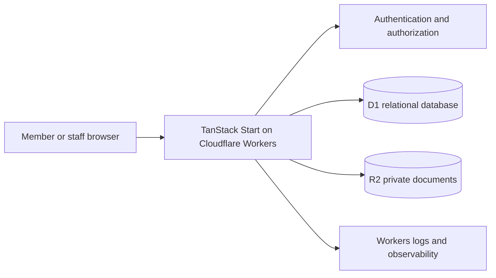

# Investment group management architecture

Status: working architecture, updated 6 November 2026. The build brief is the initial source of requirements, not a completed accounting specification. This document separates implemented capabilities from business rules that require confirmation by the general manager and board.

## Purpose and boundaries

The application should give authorized RNIG members a clear view of the group's holdings and let the general manager administer members, shares, loans, investments and reports. Mera Investment Limited's relationship to the group must be confirmed before introducing legal-entity boundaries or financial consolidations. Membership is currently closed; access should be controlled by an administrator rather than an unrestricted public sign-up flow.

The requested platform is TanStack Start on Cloudflare, reusing suitable design, technology and double-entry accounting patterns from the money-lending system. The source system records individual debit or credit transactions, but does not provide a balanced general ledger; its audit and payment patterns are useful references. Its loan formulas are not evidence of RNIG's actual rules.

## System shape

- **Workers and TanStack Start:** render routes and execute server functions. Validate every input at the server boundary; authenticate and authorize each protected read and mutation there, regardless of client-side navigation guards.
- **D1:** source of truth for identities, permissions, domain records, journal entries and audit events. Schema migrations are versioned and applied separately to development and production. Use integer minor currency units and explicit currency codes; store dates, rates and precision deliberately rather than using floating-point arithmetic for money.
- **R2:** private source documents and supporting evidence when document upload is needed. D1 stores metadata and ownership/access references; the Worker checks authorization before serving an object. Avoid public buckets for sensitive member records.
- **Observability:** record operational errors without credentials or sensitive financial details. Keep business audit events distinct from application logs.
- **Environments:** separate local, test and production databases, secrets and object storage. A preview must not silently point at production records. Configuration and infrastructure bindings are documented in the repository; secrets are provisioned separately.

Start with the smallest set of services needed. Scheduled work, queues, email delivery and other Cloudflare products can be introduced when a verified workflow needs them; they are not required to make a ledger correct.

## Modules and ownership

| Module | Responsibility | Important boundaries |
| --- | --- | --- |
| Identity and access | Credentials, sessions, administrative member provisioning and role assignments | Server-side authorization on every action; default-deny sensitive records. |
| Members and shares | Member profiles, dated share positions, issuance and transfer records | Preserve ownership history; block external transfers unless policy changes. Do not infer a share price. |
| Lending | Separate loan agreements, disbursements, repayments, credit bookings and collateral references | Member-only borrower checks; retain each loan's dates and terms; do not implement unconfirmed interest or recovery rules. |
| Investments and policy | Investments, dated transactions and valuations, income, IPS targets and budgets | Separate cost, cash income and dated valuations; valuation changes are not cash receipts. |
| Share sales | Sale requests, anonymous announcements, interest and recorded outcomes | Approval, allocation and settlement rules require confirmation before automatic transfers. |
| Accounting | Chart of accounts, balanced journal entries and transaction-to-journal links | Shared posting boundary; source records and journal postings must remain consistent. |
| Reporting | Authorized portfolio, lending and financial views for selected periods | Show source, as-of date and valuation basis; omit calculations without an approved definition. |

## Identity, access and security

Email and password authentication is required. During development, email confirmation is disabled so test accounts can be created; this is an explicit temporary configuration and must be revisited before real-member rollout. Test credentials must be clearly identified as non-production and kept out of the repository. Restrict account creation to an administrator-controlled process before actual member data is introduced.

Model identities separately from member records so a member can be provisioned, suspended or linked to an account without destroying their historical holdings. Start with least privilege: members see their own private details and only group information expressly authorized for members; staff operations require server-side permissions. The precise role and data-visibility matrix needs board approval. Protect sessions with appropriate secure cookies, validate mutations and CSRF protections, throttle authentication attempts, and store passwords using the authentication library's supported password hashing. Never place secrets or session tokens in client bundles or logs.

## Financial integrity and auditability

Financial mutations go through one posting service rather than having screens write directly to ledger tables. An approved financial event carries a stable source identifier and creates a balanced journal entry with at least two lines; total debits equal total credits per currency. Reject invalid accounts, unbalanced entries, duplicate source events and inappropriate period changes. Link each posted entry to its source event and actor, retain effective and recorded timestamps, and make retries idempotent. Use atomic database operations for a business event and its journal lines; design and test the transaction boundary against the actual D1 API before implementation.

Posted entries are immutable. Correct mistakes through linked reversal and replacement entries rather than deleting history. Protect period closure and reopening with explicit permission and an audit trail once the organization approves that workflow. Reconciliation checks should compare journal balances with source records and cash statements; opening balances and their supporting evidence must be approved before use. Ledger design is subject to the GM's actual statements and accounting policies; this document makes no claim of IFRS compliance.

Loan principal, interest, repayment allocation, income recognition and collateral recovery must each have approved account mappings and examples before their posting rules are enabled. A loan is its own contract with rate and effective dates; a member's multiple loans cannot be collapsed into one maturity or interest timeline. Record credit demand separately from a funded loan, and do not create a disbursement merely because a booking exists.

## Decisions awaiting validation

1. Legal structure, ownership of records, roles and visibility, and opening balances.
2. Loan calculation: reducing balance versus compounding, day count, rounding, dates, rate changes, allocation of repayments and delinquency. Confirm the stated 10% annual and 5% six-month figures and their meaning.
3. Share-price basis and dates; borrowing capacity across loans; approval, security and application of the stated excess-borrowing rate.
4. Default triggers, pledged-share recovery, sales, proceeds allocation and treatment of any shortfall or unsold shares.
5. Sale announcement, board notification, allocation, partial fills, settlement and group buyback rules.
6. IPS targets, asset-class mapping, budget and valuation bases, income categories, financial statements and reporting calendar.

Until approved, store relevant facts and surface their status without presenting a speculative calculation or executing an irreversible financial or ownership action. Obtain the share register, loan and credit-booking records, IPS tracker, financial statements and other source materials; have the GM validate imports and balances.

## Implementation status

The application is deployed at `investments.fidexa.org` on a Cloudflare Worker with a D1 database. Email/password sign-in and administrator-controlled member invitations are implemented; public sign-up and email confirmation are disabled for development. Test accounts are separate from member records and require an explicit member link for private member views. The application does not yet provide a password-reset flow or email delivery.

| Area | Implemented capabilities | Remaining decision or verification |
| --- | --- | --- |
| Members and shares | Member register, imports, dated share events and holding observations, account linking, published indicative values, member-to-member trade records and anonymous sale notices. | Validate source registers, joint holdings, share-price basis and settlement/ownership rules before relying on imported positions or automating transfers. |
| Lending | Separate member loans, dated terms and repayments, credit bookings and fulfilments, collateral records, source corrections, explicitly mapped balanced journal postings and printable recorded acknowledgments. | Interest, repayment allocation, current balances, borrowing capacity and collateral recovery depend on the GM's rules and are not calculated automatically. The acknowledgment screen and links were checked locally with synthetic data; print output still needs verification. |
| Investments and policy | Investment register, transactions, dated valuations, policy ranges and user-selected allocation comparisons. | Confirm the current policy, mappings, valuation basis and accounting classifications before treating comparisons as approved compliance or financial statements. |
| Accounting and reports | Chart of accounts, balanced journals, reversals and corrections, trial balance, cash activity, working papers, budget comparisons and frozen board-pack drafts with explicit selections. | Validate account mappings, opening balances, statement conventions and reporting periods against the GM's records. Reports describe recorded selections, not an independently reconciled set of books. |
| Member visibility | Linked members can view their recorded private information and group information explicitly published for members; board packs can be shared with selected accounts. | Confirm the final role and visibility matrix with the group before onboarding real members. |

The local browser test of a cash-payment budget comparison used a UGX 100,000 budget and a selected UGX 40,000 payment; the displayed difference was UGX -60,000. The test suite and production build passed for the lending acknowledgment, and the deployed acknowledgment route redirects unauthenticated requests to sign-in. Local browser testing also covered the acknowledgment screen, the disbursement and repayment posting reviews, and a partial credit-booking fulfilment with synthetic data. Print output remains to be checked.

On 6 November 2026, a synthetic repayment for UGX 1,235 minor units was reviewed, edited and recorded locally, then explicitly posted to synthetic cash and loan receivable accounts. The reconciliation showed the matching UGX 1,235 debit and credit, and the trial balance showed equal total debits and credits of UGX 186,235 across the local synthetic records. This checks that path through the interface; it does not approve real account mappings or loan allocation rules.

On 6 November 2026, the deployed development workspace was opened in an existing administrator browser session. The dashboard and lending register loaded against Cloudflare, and the register showed the updated repayment review control. The deployment contained no member, loan or investment records at that check. A separate fresh test-administrator sign-in also succeeded without email verification; its newly created session was then signed out. These checks do not verify production financial data.

The local share-sale browser test used a synthetic seller and a separate linked synthetic member. The administrator recorded and published a seven-share notice; the member saw its quantity and price without the seller name or private note and recorded interest in three shares. This records interest only; it does not establish allocation or settlement. Automated announcement tests also check the returned fields and access restrictions.

A subsequent local browser test recorded a synthetic three-share trade and matching seller sale and buyer purchase events. The reconciliation screen required both sides to total three shares, showed the source records for review, and saved the link in its history. This link does not itself transfer ownership or establish settlement.

## Delivery and verification

1. Establish the TanStack Start/Workers foundation, D1 migrations, authentication, restricted provisioning and a protected app shell. Verify sign-in, session protection and basic navigation in a browser.
2. Add members and share records with access checks and traceable historical changes. Introduce test data only, clearly labeled.
3. Build and test a balanced ledger, adapting the lending system's audit and payment patterns, then add member-only loan and booking records. Enable financial posting and calculations only for approved rules and account mappings.
4. Add investment records, dated valuations, income and policy tracking, followed by reporting with explicit dates and source data.
5. Continue share-sale and default workflows once approvals and settlement rules are agreed. The existing records do not automatically transfer shares or settle debt. Validate period reports and opening balances with the GM before real use.

For each increment, test authorization at the server boundary, schema constraints, financial invariants and failure/retry behavior as appropriate. Manually exercise representative paths in a browser while building, and run integration tests against the Workers/D1 environment for persistence and ledger operations. A deployed application is not ready for actual funds or member records until its rules, access matrix, recovery procedure and opening data have been reviewed and validated.

## Source-document refinements

The September 2026 board pack presents investment policy as dated allocation **ranges**, not only a single target, and compares several dimensions of performance (p. 16). Model policy versions and lower/upper bounds after the GM confirms the current IPS; the domain schema supports both point targets and ranges, without interpreting them as approved compliance rules. Credit bookings also have borrower-held and partially fulfilled states (financial statements p. 28). Record hold/resume and fulfilment history without choosing queue rules. Track company borrowings and member deposits separately from member loans (statements pp. 34–35). The 2022 and 2026 shareholder registers are dated snapshots, so validate joint holdings, transactions and opening balances before importing them. The supplied 2026 statement identifies an unbalancing figure, so its figures require reconciliation rather than automatic posting (p. 10). See [financial decisions](financial-decisions.md) for source references and unresolved rules.
